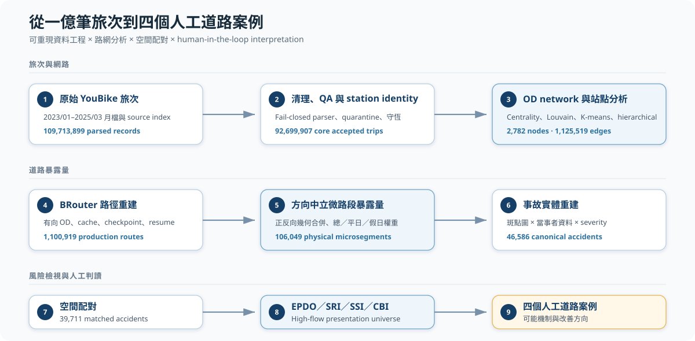
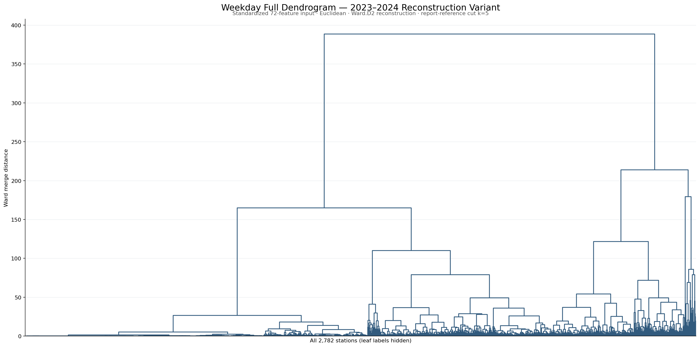
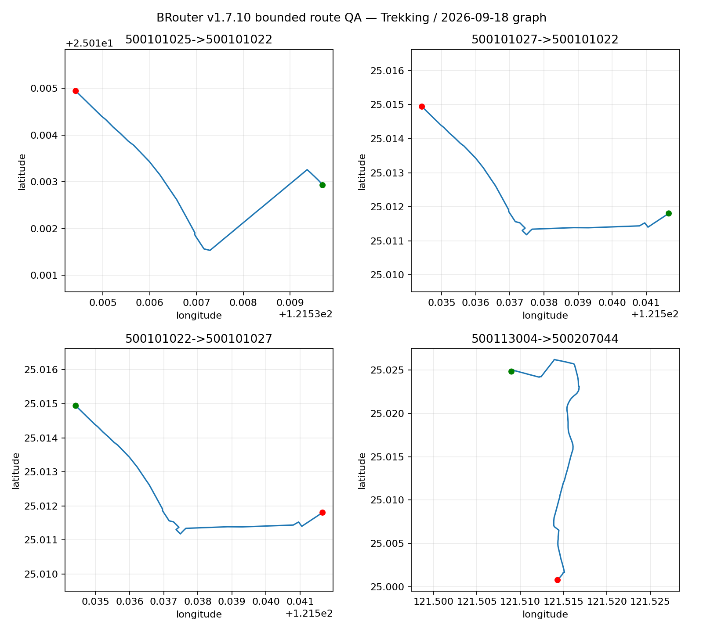
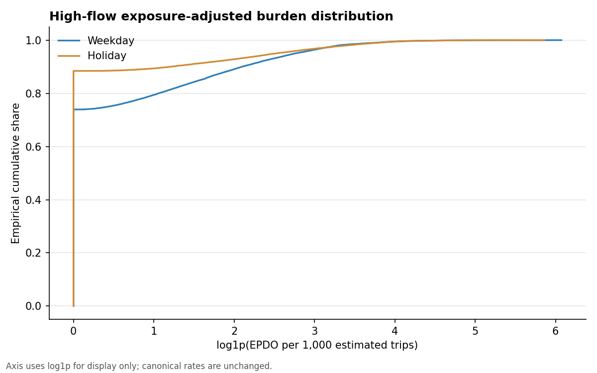
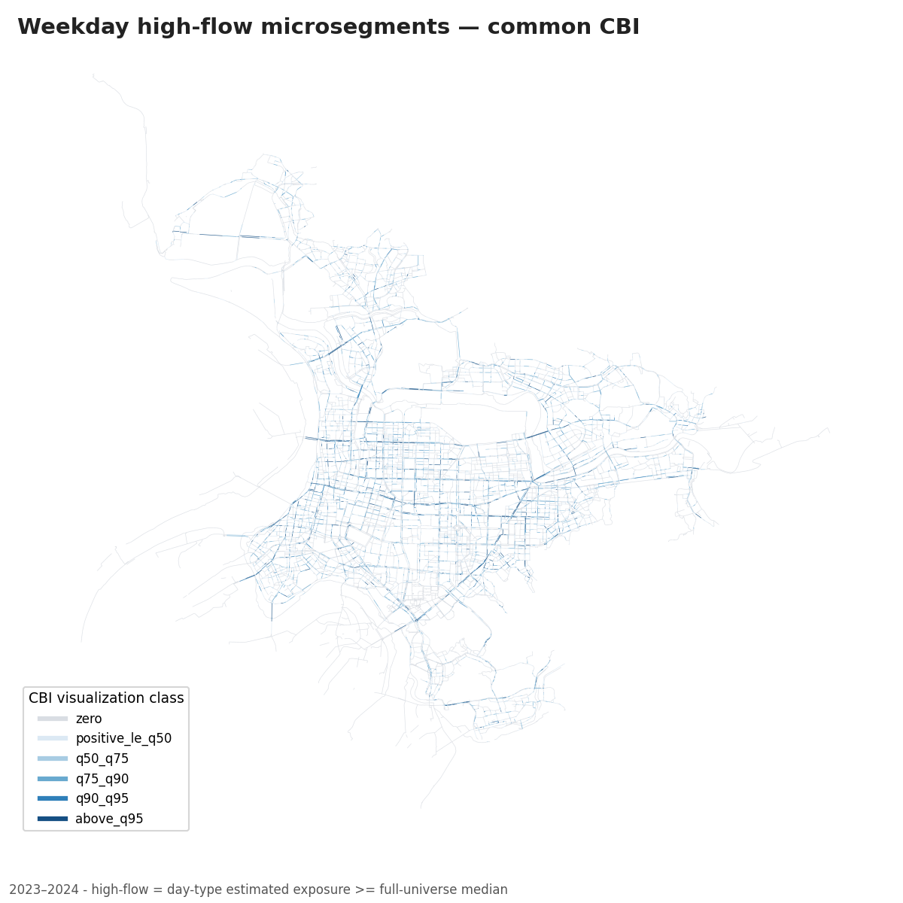
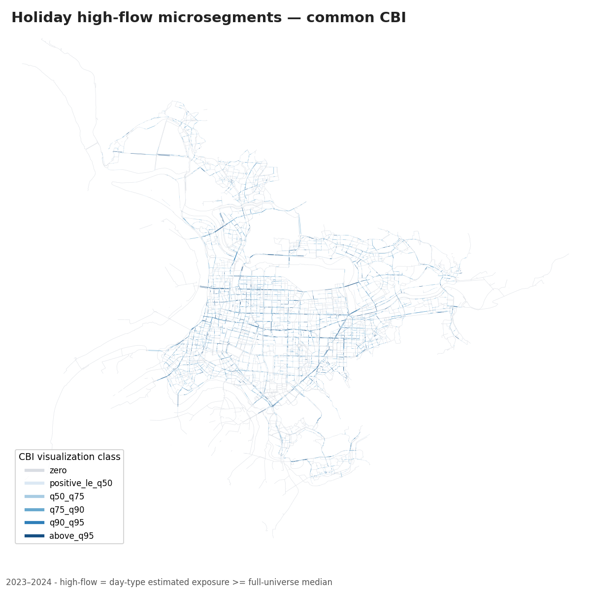
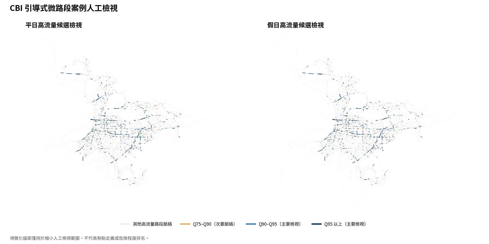

# 臺北 YouBike 路網與道路風險重建

本研究整合臺北 YouBike 旅次、2023–2024 年死傷交通事故與 BRouter 路徑重建資料，建立可重現的道路風險檢視流程。分析從一億筆以上的原始旅次出發，重建 OD 網路與道路微路段暴露量，再以事故頻率、嚴重度與人工道路情境檢視，縮小值得進一步觀察的範圍。

> 資料幫助找到值得看的地方，道路脈絡則幫助理解可能需要改善的是什麼。



## 研究問題

1. YouBike 騎乘主要集中在哪些站點與路網？
2. 哪些高流量道路微路段具有較突出的事故頻率與嚴重度？
3. 這些數值在實際道路環境中，可能對應哪些通行問題？

## 核心成果

| 分析節點 | 結果 |
|---|---:|
| 2023/01–2025/03 完整解析旅次 | 109,713,899 筆 |
| 2023–2024 核心期間清理後接受旅次 | 92,699,907 筆 |
| 核心 OD 網路 | 2,782 個節點、1,125,519 條有向邊 |
| 完成 BRouter 生產路由 | 1,100,919 條 |
| 方向中立微路段（direction-neutral physical microsegment） | 106,049 段 |
| 重建事故實體 | 46,586 件 |
| 正式配對事故 | 39,711 件（85.2423%） |
| 已配對且可分類事故 | 39,705 件：124 fatal（死亡）、39,581 injury（受傷） |
| 觀察到的 EPDO 總量 | 4,654,909 |
| 高流量呈現範圍 | 平日 53,032 段；假日 53,025 段 |

完整 denominator、排除帳與資料指紋保留在各階段的 [notes](notes/) 與 machine-readable receipts；README 僅呈現理解研究故事所需的核心數字。

## 資料

| 資料來源 | 在研究中的用途 | 詳細稽核 |
|---|---|---|
| 臺北市 YouBike 2.0 票證刷卡資料 | 旅次清理、OD 聚合、時間尺度網路與路由權重 | [資料品質剖析](notes/data-quality-profile.md)、[全期間清理](notes/full-period-cleaning.md) |
| `2020_2025假日.fst` | 以 `IsHoliday` 區分平日與假日；不使用週末規則猜測 | [假日資料稽核](notes/holiday-calendar-audit.md) |
| BRouter 1.7.10 與固定 Trekking profile / RD5 graph | 重建站點間實際道路路徑與微路段暴露量 | [路由契約](notes/brouter-routing-reconstruction-contract.md)、[生產路由完成紀錄](notes/phase8_1c-routing-production-completion.md) |
| 臺北市死傷交通事故明細與事故斑點圖 | 重建一事故一實體、事故嚴重度與空間位置 | [事故資料稽核](notes/phase8_3a-accident-data-audit.md)、[事故實體重建](notes/phase8_3a2-accident-entity-reconstruction.md) |
| `8mroadup/Road.shp` | 提供事故道路語境，限制事故候選道路範圍 | [道路參考驗證](notes/phase8_3b-accident-road-reference-validation.md)、[道路語境契約](notes/phase8_3c-accident-road-context.md) |

原始資料與大型中間成果不進 Git；repository 保留程式、測試、設定、圖表、方法文件與小型 receipts。

## 資料處理與分析流程

### 1. 從原始旅次到 OD 網路

- Parser 依實際內容辨識 6／7 欄與有／無 header，不以年月硬編碼 schema。
- 非法 UTF-8 bytes 保留原始證據；未知 schema 或未審查車種採 fail closed。
- 清理執行具備 quarantine、原子寫入、record conservation 與 deterministic receipt。
- 重複的完全相同旅次全部保留，未使用 `drop_duplicates()`。
- 2023–2024 核心網路保留 91,138,763 筆 OD-eligible trips，形成 2,782 個站點與 1,125,519 條有向 OD 邊。

### 2. 網路分析與分群

核心網路計算 strength、betweenness centrality、eigenvector centrality、PageRank 與 clustering coefficient，並重建 Louvain、K-means 及分層式分群。分群結果用於理解站點功能與時間型態，不作為道路風險分數。



### 3. BRouter 路徑與道路微路段暴露量

每個可路由的有向 OD pair 只呼叫一次 BRouter；平日、假日與總量只是不同權重，不重複 routing。生產流程以 SQLite cache、checkpoint、atomic write 與 resume 機制完成 1,100,919 條路由，再串流聚合為道路路段使用量。



正反方向 BRouter segments 依相同端點組合為 106,049 個方向中立微路段。暴露量（exposure）是重建路徑通過該微路段的加權 traversal，不是 GPS 觀測流量、官方交通量或唯一騎士人數。

### 4. 事故實體重建與空間配對

事故斑點圖與事故明細先依時間、位置文字與座標重建為 46,586 個 canonical accident entities。正式 matching 以 Road.shp 道路語境優先、10 m 分析門檻、context-empty 不 fallback、exact tie 不猜測的規則，將 39,711 件事故配對至方向中立微路段；未配對狀態完整保留於排除帳。

## 核心分析方法

### OD network 與 station/network analysis

站點為節點、借還站組合為有向邊，旅次數為 edge weight。平日／假日與小時尺度的網路使用同一組 canonical station identity，中央性與分群方法的方向、權重、自迴圈與標準化規則皆在各自 contract 中鎖定。

### EPDO、SRI、SSI 與 CBI

等值財損事故（Equivalent Property Damage Only, EPDO）的原始定義為：

```text
EPDO = 193 × fatal + 117 × injury + 1 × PDO-only
```

目前沒有完整可用、可空間配對的 A3／PDO-only 事故資料，因此 **PDO component = unobserved**，不是 `PDO = 0`。本研究實際計算的是：

```text
observed EPDO = 193 × observed fatal + 117 × observed injury
```

相對事故頻率指標（Relative Frequency Index, SRI）與相對嚴重度指標（Relative Severity Index, SSI）在共同的 106,049 段 universe 上正規化；綜合自行車指標（Composite Bicycle Index, CBI）定義為：

```text
CBI = SRI + SSI
```

CBI 不包含自行車 exposure。`EPDO per 1,000 estimated trips` 則描述相對於 BRouter 重建暴露量的嚴重度加權負擔；high-flow flag 只限定研究與呈現範圍。三者沒有被合併成單一 super score。

## 高流量呈現範圍與穩定性

原始微路段的 EPDO／1,000 estimated trips 會因低 exposure denominator 出現極端值。沿用原研究既有的 `day-type exposure >= 全體中位數` 作為 high-flow presentation universe 後，尾端明顯收斂：

| Day type | 指標 | 全體微路段 | High-flow universe |
|---|---|---:|---:|
| 平日 | Max | 312,000.000 | 433.333 |
| 平日 | P99 | 195.980 | 41.443 |
| 假日 | Max | 175,500.000 | 350.183 |
| 假日 | P99 | 100.367 | 42.810 |

這是支持 median high-flow universe 作正式呈現範圍的**描述性證據**，不代表中位數是統計最佳門檻，也不代表低流量微路段沒有風險。



## 平日與假日 CBI 呈現

下圖使用同一組 canonical CBI 與共同 visualization classes；顏色只用來縮小人工檢視範圍，不是 hotspot 定義或危險程度排名。

| 平日高流量微路段 | 假日高流量微路段 |
|---|---|
|  |  |

## 四個人工檢視案例

四個案例是研究者在 CBI-guided review map 上結合道路環境後人工選定的 **human-reviewed case studies**，不是自動 ranking、hotspot detector 或 Top-N。案例單位是實際道路環境，不是單一 BRouter `physical_segment_id`；研究者未正式留存 reference microsegment IDs，因此本專案不依地名或近似座標反推 ID。

| 案例 | 人工檢視主題 | 值得進一步檢視的方向 |
|---|---|---|
| A｜民權東路二段 | 地下道出入口與自行車通行空間 | 空間整合與交會管理 |
| B｜百齡橋橋頭 | 自行車上橋入口導引 | 入口辨識與提前導引 |
| C｜基隆路二段 | 高車流混合通行與公車站／YouBike 出入口交織 | 匯入交織與視距管理 |
| D｜大度路一段 | 長距離混合通行與退出選擇受限 | 退出選擇與長距離騎乘容錯 |

完整的資料證據、道路現況觀察、可能風險機制、改善方向與研究限制，見 [四個人工案例正式紀錄](notes/phase8_6b-human-case-studies.md)。



亦可開啟 [互動式人工檢視地圖](figures/interactive/phase8_6a_case_candidate_review.html) 縮放、切換平日／假日圖層並查看 canonical metrics。互動地圖不會寫回資料，也沒有建立 selected-case 狀態。

README 與案例文件未收錄或 commit 任何第三方街景截圖；道路環境以研究者文字觀察呈現，避免在授權與 attribution requirements 未確認前重新發布影像。

跨案例共同顯示，自行車環境不能只看「有沒有設施」，還需檢視設施是否容易辨識、是否連續、是否與行人／公車／一般車流妥善整合、關鍵視距是否足夠，以及使用者是否有安全退出或替代選擇。這些是可能風險機制，不是因果結論。

## 研究限制

- A3／PDO-only 事故缺乏完整可用的空間資料，因此 PDO component 為未觀察；EPDO、SRI、SSI 與 CBI 只代表目前 fatal／injury accident population 的涵蓋範圍。
- BRouter exposure 是估計 routing exposure，不是 GPS 觀測、官方道路流量或唯一騎士人數。
- 事故 matching 仍有明確排除狀態；39,711／46,586 的配對率不是 100%。
- 10 m matching threshold 是分析決策，不是法規或自然形成的真值。
- BRouter microsegments 是 routing geometry，不是官方道路 corridor；本研究未做 corridor aggregation 或 smoothing。
- CBI = 0 只表示在目前可用事故資料與 matching 規則下沒有觀察到計分事故，不等於安全或沒有事故。
- High-flow median 是研究與呈現焦點門檻，不是統計最佳 cutoff，也不是 risk score。
- 街景與地圖人工判讀只能形成待檢視的可能機制，不能建立因果；影像日期也可能不同於 2023–2024 研究期間。
- New Taipei-origin trips 並非完整母體；跨市結果需保留 observation-boundary caveat。

## 可重現性與驗證

- 原始資料唯讀且不進 Git；大型 Parquet、BRouter cache 與 runtime logs 皆由 `.gitignore` 排除。
- Parser、清理、路由與空間配對皆使用 fail-closed gates；無法安全判定時保留 quarantine 或 explicit unresolved state。
- 主要產物具有 deterministic fingerprints、SHA-256、machine-readable receipts 與守恆檢查。
- BRouter production runner 支援 cache、checkpoint、atomic write 與 resume；完成狀態另經逐 route 驗證。
- 測試涵蓋 schema drift、非法 UTF-8、record conservation、routing cache、spatial matching、metric contracts 與文件完整性。

核心方法與 QA 可從下列文件開始：

- [重建決策紀錄](notes/decisions.md)
- [OD inclusion policy](notes/od-inclusion-policy.md)
- [Network metric contract](notes/network-metric-contract.md)
- [事故實體重建](notes/phase8_3a2-accident-entity-reconstruction.md)
- [事故至微路段正式配對](notes/phase8_4b-accident-brouter-matching.md)
- [風險輸入契約](notes/phase8_5a-risk-input-contract.md)
- [風險穩定性稽核](notes/phase8_5b-stability-audit.md)
- [CBI 呈現契約](notes/phase8_5c-risk-presentation.md)

## 技術棧

實際使用的工具包括 Python、R、SQLite、Pandas、PyArrow／Parquet、NumPy、SciPy、scikit-learn、NetworkX、igraph、Shapely、PyProj、PyShp、Matplotlib、Folium／Leaflet、BRouter、Git 與自動化單元測試。SQL 用於 SQLite-based cache、profiling 與磁碟式 aggregation，不將大型 geometry 全數載入記憶體。

## Quick start

### A. 輕量作品集閱讀

不需要下載原始資料即可閱讀：

1. 從本 README 了解研究故事與核心結果。
2. 查看 [`figures/`](figures/) 的靜態圖與 [互動式案例地圖](figures/interactive/phase8_6a_case_candidate_review.html)。
3. 依需要進入 [`notes/`](notes/) 查看方法、限制、receipts 與決策依據。

### B. 完整重建

完整重建需要另行取得 2023/01–2025/03 YouBike 原始月檔、假日資料、臺北市事故資料、Road.shp，以及固定版本的 BRouter、Trekking profile 與 RD5 graphs。清理後 Parquet、production manifest、1.1M route cache 與大型中間產物均不包含在 Git 中；因此 clone repository 後不能直接重跑一億筆旅次與全量 routing。環境版本見 [`requirements.txt`](requirements.txt)，路由環境與執行方式見 [production runbook](notes/phase8_1a-production-runbook.md)。

## 專案結構

```text
src/                 資料稽核、清理、網路、路由、空間配對與指標程式
tests/               合成 fixtures、契約測試與完整回歸測試
notes/               方法文件、決策、QA、receipts 與案例紀錄
figures/             作品集靜態圖與互動地圖
reports/figures/     網路／路由階段代表圖
config/              鎖定的分析與 routing contracts
data/processed/      本機大型處理成果；Git 僅保留目錄標記
runs/                小型可提交 receipts 與執行紀錄
```

## 結論

本專案不是要宣稱找出「臺北最危險的道路」，而是以大規模 YouBike 旅次、路徑重建與死傷事故資料，建立一套可重現、可稽核的道路風險檢視流程。CBI 提供事故頻率與嚴重度的相對視角，暴露調整指標補充不同流量條件下的負擔，而 high-flow universe 讓人工檢視聚焦於較具使用量的道路環境。

最終改善判讀仍需回到實際道路脈絡。資料分析負責縮小值得關注的範圍，人為判讀則負責理解設施辨識、動線交織、視距與退出選擇等可能需要改善的地方。
