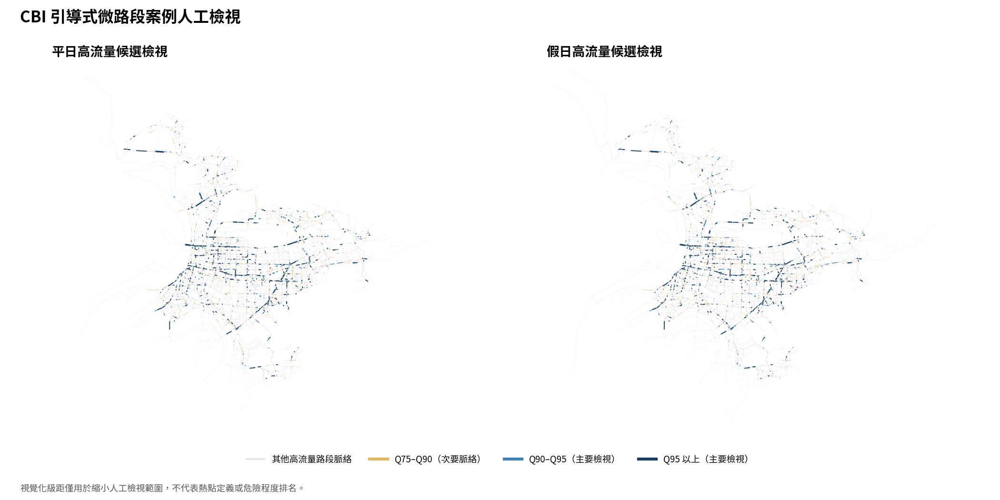

# Phase 8.6A — CBI-guided Case Candidate Review Pack

本階段只把既有 Phase 8.5C 呈現分類轉成可供研究者人工看圖的候選清冊。資料只負責縮小檢視範圍，不替研究者選定最終案例；沒有建立排名、Top-N、hotspot、二元風險標籤、新 CBI／exposure cutoff、corridor、平滑或道路改善建議。

## Locked inputs

- Phase 8.5C presentation artifact：106,057 rows，grain 為 `(day_type, physical_segment_id)`。
- Phase 8.5C fingerprint：`2e6d9f763b0370abbf3785c9e510f04b36cde415947b156eccc7223129af2ea0`。
- Phase 8.5C Parquet SHA-256：`8d818cd74c7b52d65488c5a0c0a97223f9ef7569e0d1ac35a26d2ca0b3e83ddc`。
- Phase 8.5C receipt fingerprint：`15c2c4ccecb8b662b52a6af35a1eabbe74b197e4f2415d2f4129483935dffe30`。
- Phase 8.5A canonical risk artifact同時作為一列一微路段及平／假日完整欄位的 locked source；其 fingerprint／SHA-256 為 `f9a3f6ba149cf8bdd4742d5e5857e03aa0a4bb8a1ab90f603199e10f103c4f14`／`dec4bf536fe692e69311371e02c905e02e19bdc49e30f45f88316e8dffcc750f`。

兩項輸入的 row count、內容 fingerprint 與檔案雜湊均在產出前 fail-closed 驗證。Phase 8.5A 只補足 worksheet 的 canonical 一列一段結構與兩種 day type 欄位；候選資格與 display class 仍完全繼承 Phase 8.5C。

## Candidate contract

主要人工檢視池只包含既有 `cbi_display_class` 的 `q90_q95` 與 `above_q95`，且該微路段至少在平日或假日一方已屬既有 high-flow universe。`q75_q90` 只作地圖上的 secondary context，不進入主要 worksheet。這些 class 是 Phase 8.5C 的視覺 metadata，不是風險類別或新分析門檻。

| Review pool | Physical segments |
|---|---:|
| Primary：`q90_q95` | 516 |
| Primary：`above_q95` | 767 |
| Primary total | 1,283 |
| Secondary context：`q75_q90` | 2,592 |

主要清冊是一列一個 `physical_segment_id`，沒有重複。平日候選為 1,270 段、假日候選為 1,255 段；其中 1,242 段兩者皆是、28 段僅平日、13 段僅假日。平假日數量不可直接相加為唯一候選數。

## Worksheet

[`phase8_6a-case-candidate-review.csv`](phase8_6a-case-candidate-review.csv) 共 1,283 rows、25 columns，保留：

- canonical CBI／SRI／SSI、事故件數、fatal／injury件數、EPDO；
- 平日／假日 high-flow 與候選旗標、exposure、EPDO per 1,000；
- segment length、canonical endpoints；
- 空白 `review_status` 與 `researcher_note`，留給人工檢視。

清冊不包含 rank、hotspot、corridor 或自動推薦欄位。CBI逐值與 Phase 8.5A 相同，display class逐段與 Phase 8.5C 相同。CSV 使用 UTF-8 BOM，寫出後會重新讀取並比對內容 fingerprint。

## Aggregate profile

以下只描述整個主要檢視池，刻意不列 individual top segments：

| Metric | P50 | P90 | P95 | P99 | Max |
|---|---:|---:|---:|---:|---:|
| CBI | 0.3158 | 0.5263 | 0.6316 | 1.0000 | 2.0000 |
| Accident count | 6 | 10 | 12 | 19 | 38 |
| EPDO | 702 | 1,170 | 1,404 | 2,223 | 4,446 |
| Weekday exposure | 39,518 | 173,056 | 279,257.7 | 626,024.16 | 1,077,423 |
| Holiday exposure | 16,728 | 73,566.4 | 115,463.7 | 248,569.74 | 434,756 |

這些分布不是選案分數，也沒有把多個欄位合成新的風險指標。

## Review map

兩張圖使用相同 extent。灰色是其他 high-flow 背景，金色是 `q75_q90` secondary context，兩種藍色是主要檢視池。線寬與顏色只協助辨識 class，沒有編碼新的排名或因果結論。

## Human review boundary

最終案例必須由研究者實際檢視地圖後，在 `review_status` 與 `researcher_note` 明確記錄選擇／不選擇理由。候選單位仍是 BRouter physical microsegment，不是官方道路路段或自然道路 corridor；相鄰微路段不可在本階段自動合併。Phase 8.6A 也沒有進行街景判讀、現場機制推論或改善建議。

持續限制包括 A3／PDO-only unavailable、BRouter exposure 為重建估計值、事故 matching exclusions，以及 10 m matching threshold 是分析決策。CBI 與 exposure-adjusted rate 都不能證明道路設計造成事故。

## Validation and readiness

- Phase 8.6A focused tests：18／18 passed。
- Phase 8.2–8.6A relevant regression：143／143 passed。
- Full regression suite：582／582 passed。
- CSV重讀、空白人工欄位、唯一鍵、候選條件、canonical CBI、inherited class與靜態圖可重現性全部通過。
- 完整重跑的 worksheet、figure、QA 與 receipt fingerprints一致。

Readiness：**PHASE 8.6A COMPLETE — HUMAN MAP REVIEW PACK READY**。

## 呈現層繁體中文化

靜態人工檢視圖的標題、子圖標題、圖例與圖說已改為台灣繁體中文，並使用 `Noto Sans TC / Microsoft JhengHei / PingFang TC / sans-serif` 字型 fallback。程式內部欄位、controlled vocabulary、候選集合與分析 artifact 均維持原英文契約。

「視覺化級距僅用於縮小人工檢視範圍，不代表熱點定義或危險程度排名。」

這只表示人工檢視包已備妥。未開始 Phase 8.6B；後續若獲得另行授權，第一步仍是由研究者檢視候選、填寫理由並明確選定案例。
